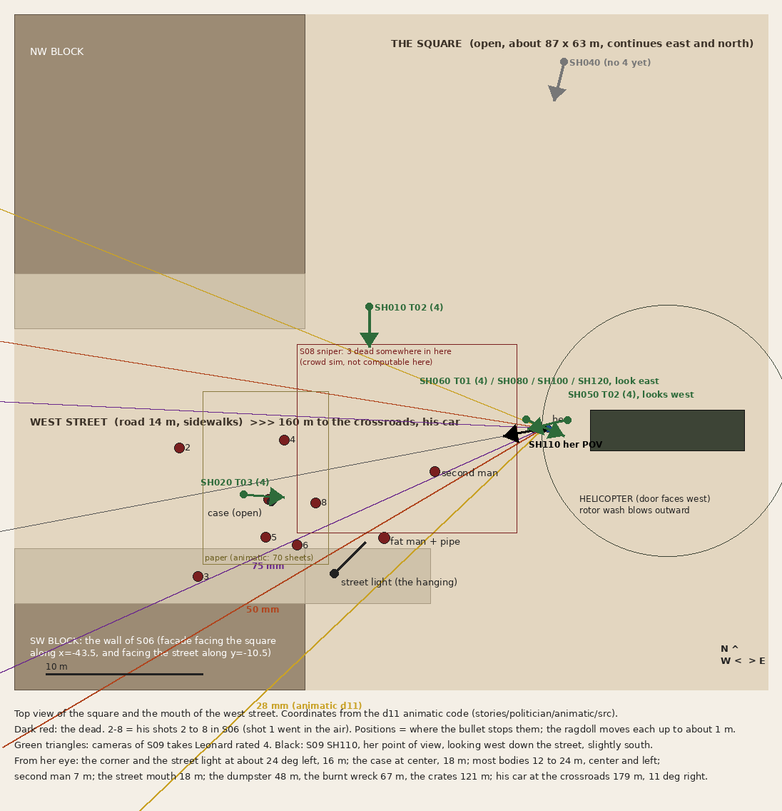

# The square: map (S05 SH140 to S09)

Top view drawn from the d11 animatic code (`stories/politician/animatic/src`: `sets.py`, `shots_s05.py` to
`shots_s09.py`), the geometry every shot was blocked on. Drawing script: `square_map_v1_draw.py`.
North is up. Units are meters.

## Fixed points

| What | Where (x, y) | Note |
|---|---|---|
| Square, open ground | x -43.5 to 43.5, y -31.5 to 31.5 | streets leave from each side |
| West street | x < -43.5, road \|y\| < 7, sidewalks to 10.5 | runs west 160 m to the crossroads |
| SW block (the S06 wall) | x < -43.5, y < -10.5 | its corner faces the square and the street |
| Street light (the hanging) | (-41.6, -8.6), arm to (-39.6, -6.6) | on the corner sidewalk |
| His fall, S06 | (-40.8, -8.1) | back to the wall corner |
| Case, open | (-45.6, -4.0) | in the street mouth |
| Helicopter | (-24.0, 0.5), door faces west | rotor wash blows outward |
| Her | (-28.0, 0.6) | a few steps from the door |
| His car | (-207.5, 2.6) | the crossroads, door open (S03 SH050) |
| Cover down the street | dumpster (-75, 9), burnt car (-95, -8.5), crates (-149, 8) | people hiding behind them |

## The dead (where the bullet stops them; each body moved up to about 1 m by the fall)

| Who | Where |
|---|---|
| S06 shots 2 to 8 | (-51.5, -0.6), (-50.3, -8.8), (-44.8, -0.1), (-46.0, -6.3), (-44.0, -6.8), (-45.8, -3.9), (-42.8, -4.1) |
| Fat man, pipe beside him (S07) | (-38.45, -6.35) |
| Second man (S07) | (-35.2, -2.1) |
| Three sniper dead (S08) | not computable without the animatic's crowd sim: inside the box on the map, at least 4 m from the street light |

S06 shot 1 went into the air, so his dead are seven [check: the screenplay notes say "his eight"].
The approved S06 SH020 T05 puts five of them 2 to 6 m from him; the animatic puts them 3.5 to 13 m.
The approved take wins where they differ on screen.

## From her eye (S09 SH110, camera (-28.3, 0.6) at 1.62 m, looking west, slightly south)

- Second man 7 m, 11 deg left. Fat man 12 m, 24 deg left.
- The corner and the street light 16 m, 24 deg left: in frame at 28 mm (the animatic lens), at the
  left edge at 50 mm, out at 75 mm.
- Most of the dead 15 to 24 m, from 8 deg right to 14 deg left. The case at center, 18 m.
- The street mouth 18 m. Dumpster 48 m, burnt car 67 m, crates 121 m.
- His car 179 m, 11 deg right: in frame at 28 and 50 mm.
- The sun is low in the west: ahead of her, facing the camera.

## Cameras of approved S09 takes (green on the map)

| Take | Looks | Shows |
|---|---|---|
| SH010 T02 (4) | south, at the corner | him at the curb, the wall and the street light |
| SH020 T03 (4) | east, from the street mouth | the case, him, the helicopter landing in the square |
| SH050 T02 (4) | west, over her shoulders | him, the street side of the square behind him: the SH110 direction |
| SH060 T01 (4) | east, at her | her, the helicopter behind |
